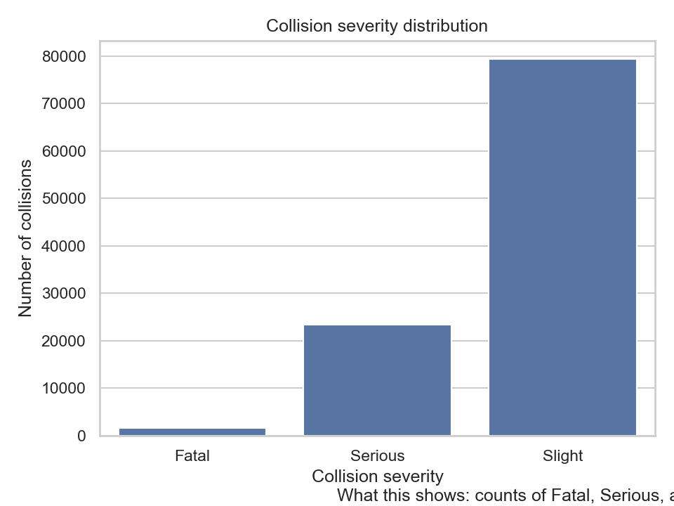
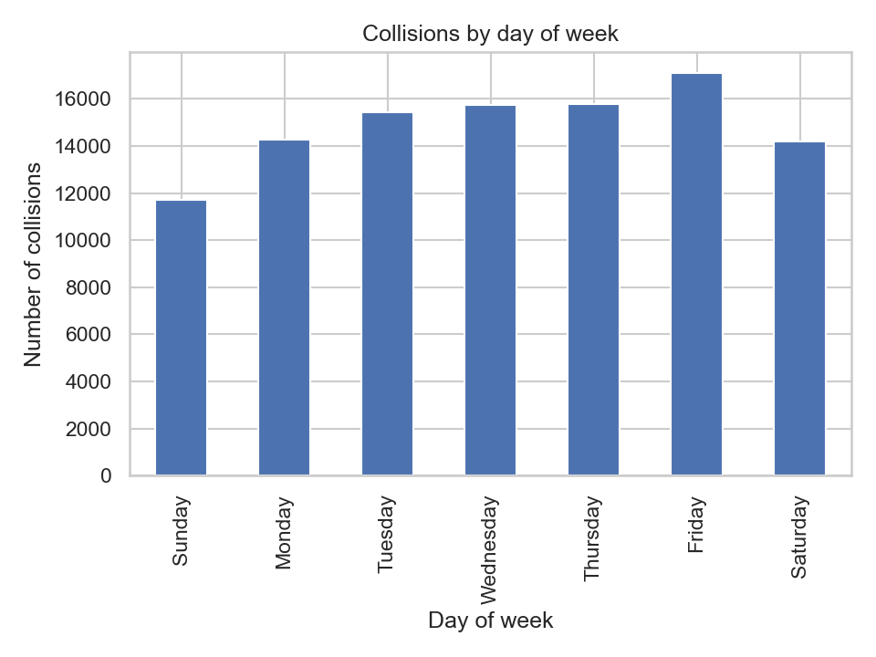
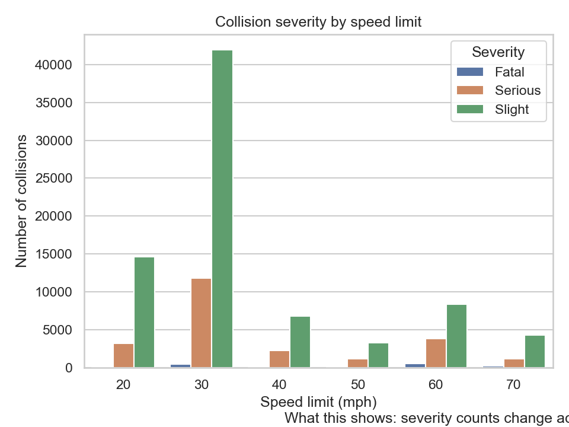
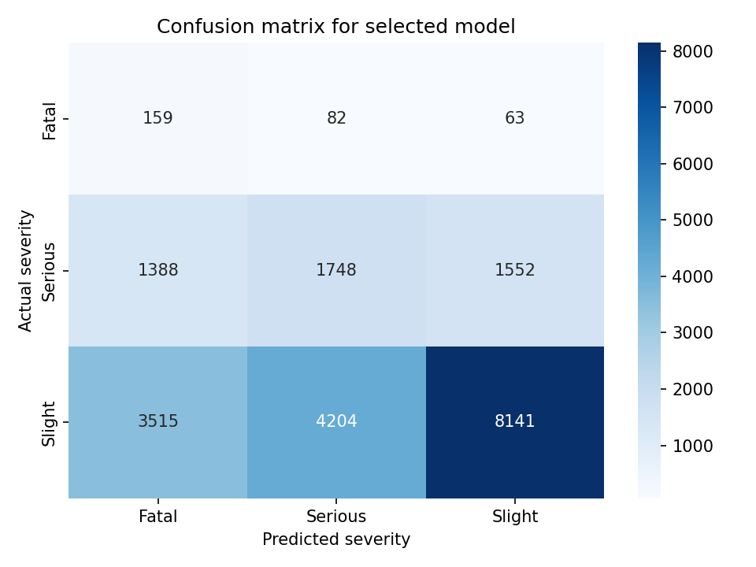

# Reproducible Data Pipelines, Tabular ML & Systems Exploration

This project uses the UK Department for Transport 2023 STATS19 collision dataset
to build a reproducible data-quality pipeline and an educational multiclass
machine-learning baseline for collision severity. Part C is intentionally not
implemented.

## Dataset

- Source: [DfT Road Safety Open Data](https://www.gov.uk/government/statistical-data-sets/road-safety-open-data)
- File: `dft-road-casualty-statistics-collision-2023.csv`
- Licence: [Open Government Licence v3.0](https://www.nationalarchives.gov.uk/doc/open-government-licence/version/3/)
- Access date: 2026-11-16
- Actual input shape: 104,258 rows and 44 columns
- Target: `collision_severity` — Fatal 1, Serious 2, Slight 3

The raw file is preserved under `data/raw/`. The cleaned file is generated under
`data/cleaned/` and is never used to overwrite the raw file.

## Setup

```bash
python3 -m venv .venv
source .venv/bin/activate
python -m pip install -r requirements.txt
```

### Reproducibility

The tested environment uses Python 3.9.6 and the pinned library versions:
pandas 2.2.3, NumPy 2.0.2, Matplotlib 3.9.2, seaborn 0.13.2,
scikit-learn 1.5.2, SciPy 1.13.1, joblib 1.4.2, pytest 8.3.3, and
python-docx 1.1.2. Training takes roughly 20 minutes on a 2-CPU environment.
Last-digit metric differences are possible when results are rerun with other
library versions or on other hardware.

## Run Part A

```bash
python -m src.inspect_data
python -m src.analysis
python -m src.visualization
python -m src.database
```

This creates inspection and quality reports, analysis CSVs, PNG figures, and a
SQLite database in `outputs/`.

### Figures



What this shows: the figure shows that Slight collisions are much more common
than Serious and Fatal collisions.



What this shows: the figure compares the number of collisions on each day of
the week.



What this shows: the figure compares severity counts at each speed limit.



What this shows: the matrix compares actual severity classes with the selected
model's predictions.

## Run Part B

```bash
python -m src.train
python -m src.evaluate
```

The selected complete preprocessing/model pipeline is saved in `models/`.
Preprocessing is fitted inside the scikit-learn pipeline using only training
data. Severity codes are 1 (Fatal), 2 (Serious), and 3 (Slight).

## Generate predictions

```bash
python -m src.predict --input path/to/unseen_records.csv --output outputs/predictions.csv
```

The input must contain the selected predictor columns and must not contain
`collision_severity`.

## Tests

```bash
pytest -q
```

## SQL result

```sql
SELECT road_type, severity_label, COUNT(*) AS collision_count
FROM collisions
GROUP BY road_type, severity_label
ORDER BY road_type, collision_count DESC;
```

The query counts collisions in the SQLite table for each road type and severity.
The largest group is road type 6 and Slight severity with 56,263 collisions.
Road type 6 also has 18,276 Serious and 1,146 Fatal collisions; these actual
numbers come from `outputs/reports/sql_road_type_severity.csv`.

## Actual findings

The dataset contains 104,258 collisions. Severity is strongly imbalanced:
1,522 Fatal, 23,438 Serious, and 79,298 Slight collisions. There were no exact
duplicates, no missing target values, and only 48 missing coordinate values.
The cleaning pipeline retained all rows, removed four outcome-derived leakage
fields, and added month, hour, and weekend features.

The held-out model comparison is:

| Model | Accuracy | Macro-F1 | Weighted-F1 | CV Macro-F1 | ROC-AUC | PR-AUC | Selected |
|---|---:|---:|---:|---:|---:|---:|---|
| Logistic Regression | 0.483407 | 0.341218 | 0.558690 | 0.337741 | 0.633519 | 0.383508 | Yes |
| Extra Trees | 0.744773 | 0.324640 | 0.674109 | 0.328841 | 0.623967 | 0.381133 | No |
| Random Forest | 0.755515 | 0.312380 | 0.671298 | 0.312272 | 0.644752 | 0.390192 | No |
| Dummy Classifier | 0.760599 | 0.288008 | 0.657174 | 0.288006 | 0.500000 | 0.333333 | No |

Because the Slight class is dominant, the Dummy Classifier has high accuracy
but weaker macro-F1. The selected model is based on macro-F1 rather than
accuracy alone. These values come from
`outputs/reports/model_comparison.csv`.

## Project structure

`src/` contains the pipeline modules, `tests/` contains unit tests,
`docs/` contains assignment documentation, `outputs/` contains generated
evidence, `models/` contains the saved pipeline, `sql/` contains the
reproducible SQL query, `data/sample/` contains the random 2,000-row input,
and `notebooks/` contains a small project exploration placeholder.
`outputs/sample/` contains separate results for the second input.

## Assumptions and limitations

The data contains coded fields and represents police-recorded personal-injury
collisions, not every road incident. Outcome-derived severity adjustment fields,
identifiers, casualty count, and police attendance are excluded from modelling
to reduce leakage. This is an educational baseline, not a validated operational
road-safety decision system. Severe collisions are a minority class, so macro-F1
and class-level recall matter in addition to accuracy.

## AI assistance

Claude and the VS Code agent were used as AI assistance for project scaffolding,
debugging, code changes, report editing, and explanations. All findings were
checked against generated files and the supplied CSV, and the student must
review and explain the code before submission.

## Reproducibility

The tested environment uses Python 3.13.12 and pandas 2.3.3, NumPy 2.2.6,
Matplotlib 3.10.7, seaborn 0.13.2, scikit-learn 1.6.1, SciPy 1.14.1,
joblib 1.4.2, pytest 8.3.3, and python-docx 1.1.2. Training takes roughly
20 minutes on 2 CPUs. Last-digit metric differences are possible on other
library versions or hardware.

## Part C

Part C (exploration homework) is intentionally not implemented.
