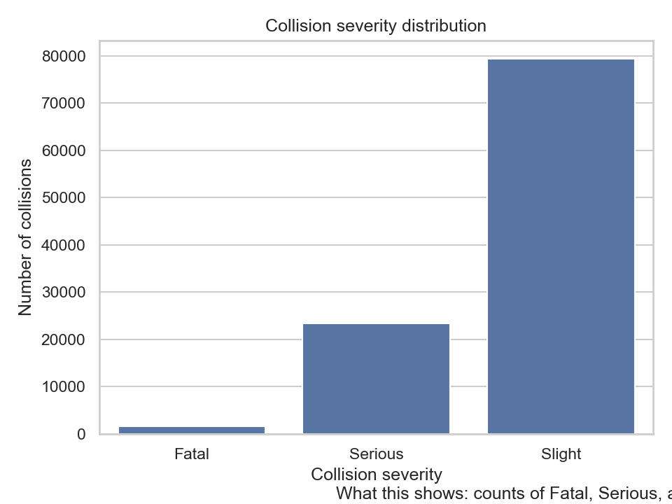
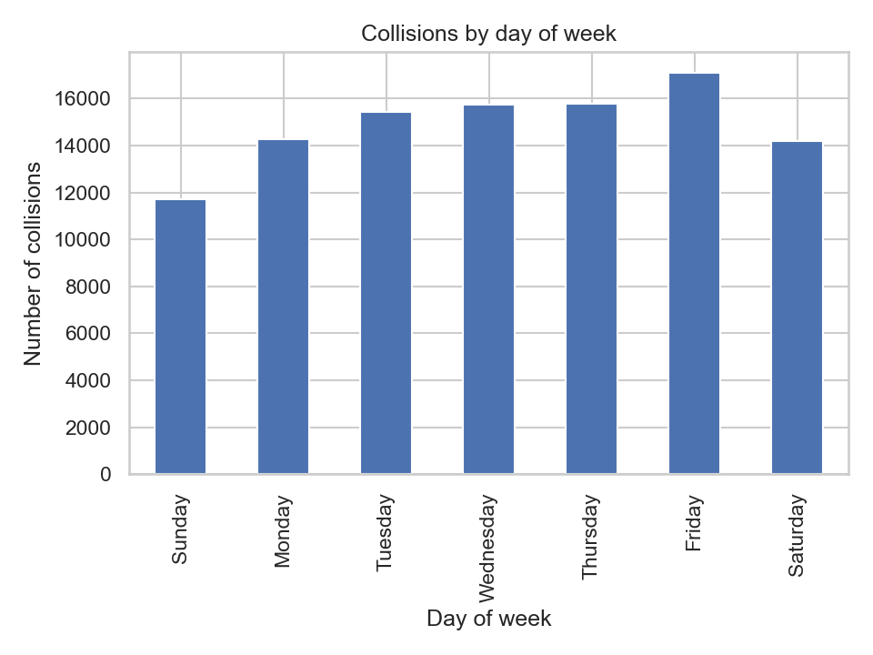
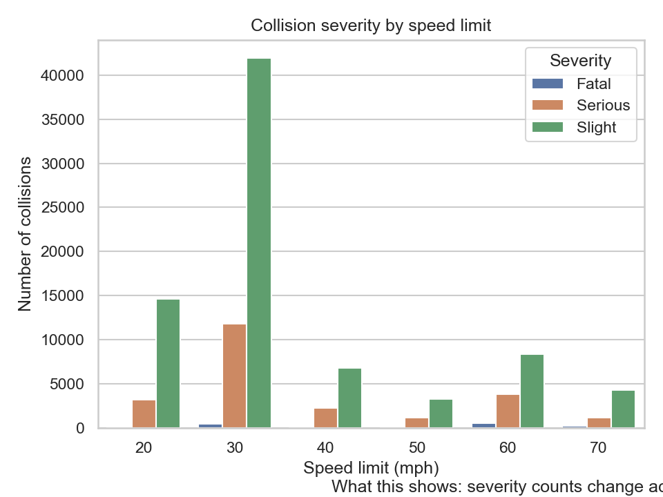
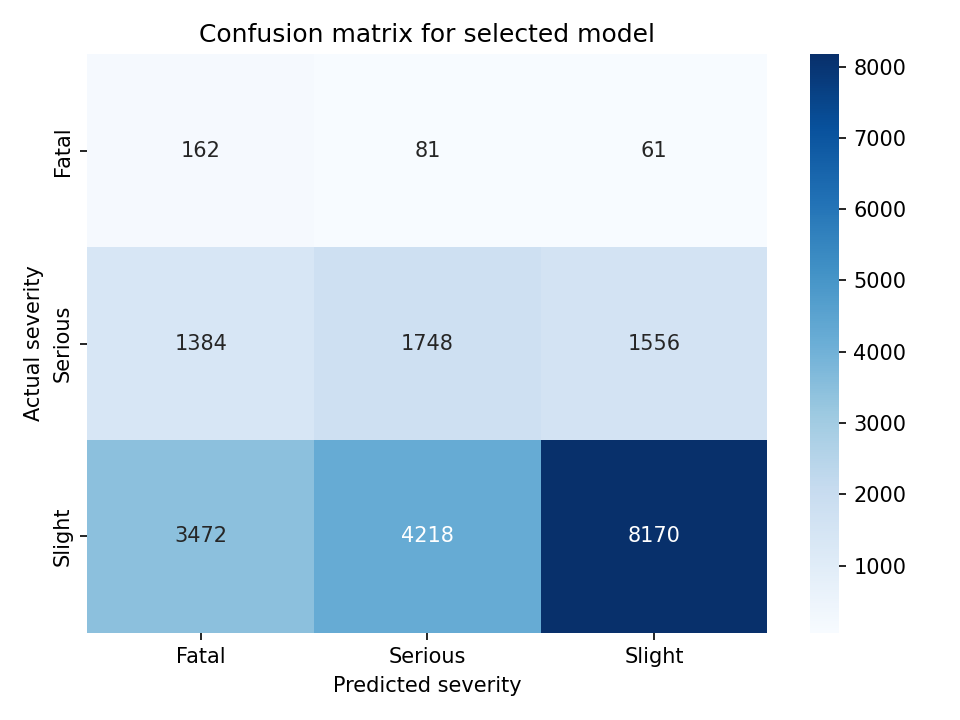

# Final Submission Report

**Student:** Syed Shaheer Haider  
**Roll number:** TRN-2026-000343  
**Project:** Reproducible Data Pipelines, Tabular ML & Systems Exploration  
**Dataset:** UK Department for Transport 2023 STATS19 collision dataset  
**Date:** 16 November 2026

## 1. Introduction

This project investigates 104,258 police-recorded personal-injury collisions
from the UK Department for Transport (DfT) 2023 STATS19 collision dataset. It
implements a reproducible data-quality workflow, exploratory analysis, SQLite
analysis, and an educational multiclass machine-learning baseline for predicting
collision severity.

The target variable is `collision_severity`:

| Code | Meaning | Records |
|---:|---|---:|
| 1 | Fatal | 1,522 |
| 2 | Serious | 23,438 |
| 3 | Slight | 79,298 |

The target is strongly imbalanced, so macro-F1, class-level recall, and the
confusion matrix are considered alongside accuracy.

## 2. Dataset and data quality

The raw dataset contains 44 columns. It includes collision identifiers,
coordinates, date and time, road and junction information, environmental
conditions, speed limit, vehicle and casualty counts, and collision severity.
The complete observed schema is documented in
[schema.md](./schema.md).

The inspection and cleaning pipeline found:

- 104,258 input rows and 44 input columns.
- No exact duplicate rows.
- No missing or invalid target values.
- 48 missing values in total: 12 in each coordinate field.
- No invalid speed limits, day-of-week codes, or negative vehicle/casualty
  counts.
- No rows rejected during cleaning.

The cleaned dataset retains all valid records, removes four outcome-derived
severity fields to reduce target leakage, and adds `month`, `hour`, and
`is_weekend`. The cleaned file contains 43 columns and is written separately
from the raw file.

The detailed evidence is available in
[data_quality_report.md](./data_quality_report.md) and
[inspection_report.json](../outputs/reports/inspection_report.json).

## 3. Implementation and reproducibility

The project is organised into separate modules:

- `inspect_data.py`: schema, missingness, duplicates, and quality reports.
- `cleaning.py`: parsing, feature creation, leakage removal, and cleaning.
- `validation.py`: checks required columns and valid coded values.
- `analysis.py`: groupby, aggregation, pivot-table, and NumPy analysis.
- `visualization.py`: reproducible charts saved under `outputs/figures/`.
- `database.py`: SQLite database creation and SQL analysis.
- `train.py`: model comparison and saved preprocessing/model pipeline.
- `evaluate.py`: held-out evaluation, classification report, and errors.
- `predict.py`: predictions for unseen records.

The complete pipeline can be reproduced with:

```bash
python3 -m venv .venv
source .venv/bin/activate
python -m pip install -r requirements.txt
python -m src.inspect_data
python -m src.analysis
python -m src.visualization
python -m src.database
python -m src.train
python -m src.evaluate
pytest -q
```

## 4. Exploratory analysis

The analysis examines severity by road type, speed limit, day, time, and
environmental conditions. Generated figures include:









The analysis also produces CSV reports for severity counts, road type by
severity, speed bands, and collisions by day. These are stored in
[outputs/reports](../outputs/reports/).

## 5. SQLite and SQL analysis

The cleaned collision data is loaded into
[road_safety.sqlite](../outputs/road_safety.sqlite). The reproducible query in
[analysis.sql](../sql/analysis.sql) groups collisions by `road_type` and
`severity_label`, returning the collision count for each combination.

This demonstrates database storage and SQL aggregation in addition to the
equivalent pandas analysis.

## 6. Machine-learning method

The target is treated as a three-class classification problem. The data is
split into stratified training and test sets using an 80/20 split. Numeric and
categorical preprocessing is fitted within each scikit-learn pipeline using
training data only. This prevents test-set information from entering
preprocessing.

The following models were compared:

- Dummy classifier baseline
- Logistic regression
- Random forest
- Extra trees

Identifiers, outcome-derived fields, casualty count, and police attendance were
excluded from the baseline to reduce leakage and avoid using information that
may not be appropriate for prediction.

## 7. Results

The held-out results are taken from
[model_comparison.csv](../outputs/reports/model_comparison.csv):

| Model | Accuracy | Macro precision | Macro recall | Macro-F1 | Weighted-F1 | CV macro-F1 | ROC-AUC | PR-AUC | Selected |
|---|---:|---:|---:|---:|---:|---:|---:|---:|---|
| Logistic regression | 0.483407 | 0.385378 | 0.473631 | **0.341218** | 0.558690 | **0.337741** | 0.633519 | 0.383508 | Yes |
| Extra trees | 0.744773 | 0.381074 | 0.344002 | 0.324640 | 0.674109 | 0.328841 | 0.623967 | 0.381133 | No |
| Random forest | 0.755515 | 0.382402 | 0.341223 | 0.312380 | 0.671298 | 0.312272 | 0.644752 | 0.390192 | No |
| Dummy classifier | 0.760599 | 0.253533 | 0.333333 | 0.288008 | 0.657174 | 0.288006 | 0.500000 | 0.333333 | No |

Logistic regression is selected for this educational baseline because it has the
highest macro-F1 and cross-validation macro-F1. The dummy classifier has higher
accuracy because the Slight class dominates, but it performs worse on balanced
class performance.

The selected pipeline is saved as
[collision-severity-pipeline.joblib](../models/collision-severity-pipeline.joblib).

## 8. Classification and error analysis

The selected model's held-out classification report is:

| Class | Precision | Recall | F1-score | Support |
|---|---:|---:|---:|---:|
| Fatal | 0.032284 | 0.532895 | 0.060879 | 304 |
| Serious | 0.289069 | 0.372867 | 0.325664 | 4,688 |
| Slight | 0.834781 | 0.515132 | 0.637112 | 15,860 |
| **Macro average** | **0.385378** | **0.473631** | **0.341218** | **20,852** |

The model identifies over half of Fatal collisions in the held-out sample, but
its Fatal precision is very low. This means many predicted Fatal cases are
actually from another class. Performance is also weaker for the minority
classes than for Slight collisions.

The concrete error pattern is that Fatal precision is 0.032284, so a large
majority of collisions predicted as Fatal are not Fatal. The highest subgroup
error rates are 92.59% for road_surface_conditions=5 (25 errors from 27 rows),
88.20% for light_conditions=6 (987 errors from 1,119 rows), 72.67% for rural
area code 2 (4,948 errors from 6,809 rows), and 66.17% for light_conditions=7
(223 errors from 337 rows).

The first five rows in `prediction_errors_sample.csv` give concrete examples:
rows 2023052300689 and 2023041380072 were actually Slight and predicted Fatal;
row 2023471329704 was Serious and predicted Slight; row 2023161374574 was
Serious and predicted Fatal; and row 2023332300633 was Slight and predicted
Serious.

The subgroup error report in
[error_analysis_by_subgroup.csv](../outputs/reports/error_analysis_by_subgroup.csv)
shows that error rates vary across road and environmental categories. For
example, the error rate is higher for rural areas (0.724) than urban areas
(0.418), while some lighting-condition groups also have substantially higher
error rates. Small groups should be interpreted cautiously.

## 9. Prediction example

An unseen sample is provided in
[unseen_sample.csv](../outputs/unseen_sample.csv), and the generated
predictions are available in
[predictions.csv](../outputs/predictions.csv). The prediction command is:

```bash
python -m src.predict \
  --input outputs/unseen_sample.csv \
  --output outputs/predictions.csv
```

The input must contain the selected predictor columns and must not contain the
target column `collision_severity`.

## 10. Limitations and ethical considerations

This project is an educational baseline and is not a validated operational
road-safety system. Important limitations include:

- The dataset covers police-recorded personal-injury collisions, not every road
  incident.
- The target is strongly imbalanced, particularly for Fatal collisions.
- DfT fields are coded and require the official data guide for interpretation.
- Predictive association does not establish causation.
- The model should not be used for emergency response, enforcement, insurance,
  resource allocation, or decisions affecting individuals.
- The results are based on 2023 data and may not generalise to other years or
  locations.

## 11. Conclusion

The project delivers a reproducible data pipeline from raw CSV through
validation, analysis, SQL storage, visualisation, model training, evaluation,
and prediction. The data-quality checks found no duplicate or invalid records,
and the cleaning process preserved all 104,258 collisions. Logistic regression
provided the strongest balanced baseline according to macro-F1, although the
minority-class results demonstrate that further modelling and data work would
be required for reliable real-world use.

## References

- Department for Transport,
  [Road safety open data](https://www.gov.uk/government/statistical-data-sets/road-safety-open-data)
- UK National Archives,
  [Open Government Licence v3.0](https://www.nationalarchives.gov.uk/doc/open-government-licence/version/3/)

AI assistance was used for project scaffolding, debugging, and explanations.
Dataset findings and reported metrics were calculated from the supplied data and
generated project outputs.
